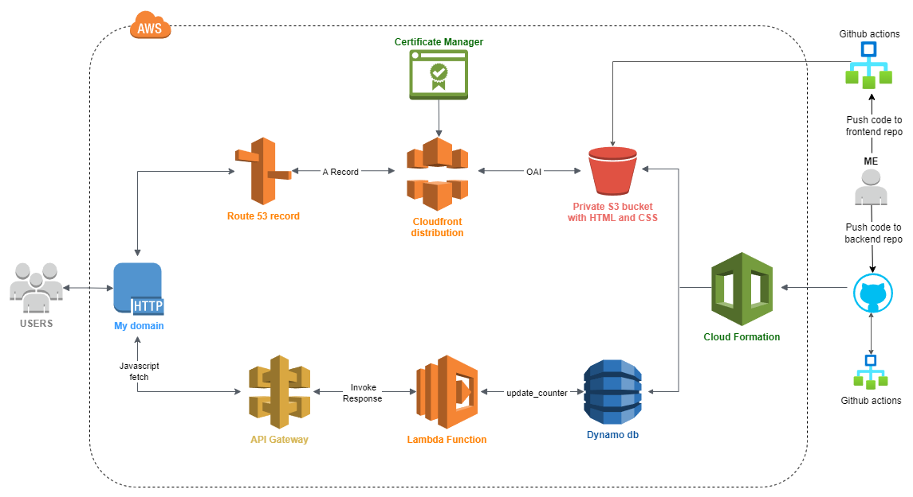

# ☁️ Cloud Resume Challenge — Frontend

🌐 **[Live Demo (luispastor.dev)](https://luispastor.dev)** &nbsp;|&nbsp; ⚙️ **[Backend & IaC Repo](https://github.com)** &nbsp;|&nbsp; 📝 **[Architecture Blog Post](https://luispastor.dev)**


Personal portfolio website built for Forrest Brazeal's [Cloud Resume Challenge](https://cloudresumechallenge.dev). This repository contains the **frontend codebase** (HTML5, CSS3, Bootstrap, and JavaScript) and the **CI/CD deployment workflow** to AWS using GitHub Actions.

---

## 🏗️ Architecture Overview



### How It Works

1. **Content Delivery & Security:** Static assets (`index.html`, `styles.css`, `js/`) are hosted in a private **Amazon S3** bucket restricted via **Origin Access Identity (OAI)** and served globally over HTTPS using **Amazon CloudFront** and **AWS Certificate Manager (ACM)**.
2. **Custom DNS:** **Amazon Route 53** manages DNS records (`A` and `CNAME`), routing traffic from `luispastor.dev` to the CloudFront distribution.
3. **Serverless Visitor Counter:** On page load, an asynchronous JavaScript `fetch()` call queries an **Amazon API Gateway** REST endpoint, triggering a Python **AWS Lambda** function that atomically increments and retrieves the visitor count stored in **Amazon DynamoDB**.
4. **Automated Frontend CI/CD:** Pushing changes to the `master` branch triggers a **GitHub Actions** pipeline (`.github/workflows/`) that syncs static files to S3 and invalidates the CloudFront cache automatically.

*(Note: All cloud infrastructure provisioning via **Serverless Framework / AWS CloudFormation**, along with the Python Lambda backend and unit tests, is managed in the [Backend Repository](https://github.com)).*

---

## 🛠️ Frontend & Deployment Stack

* **Frontend:** HTML5, CSS3, Bootstrap 5, Vanilla JavaScript (Fetch API), Typed.js
* **AWS Hosting & Edge Services:** S3, CloudFront, Route 53, Certificate Manager (ACM)
* **CI/CD Pipeline:** GitHub Actions (`aws s3 sync` + CloudFront invalidation)
* **Backend & IaC:** Python 3.9, API Gateway, Lambda, DynamoDB, Serverless Framework ([View Backend Repository](https://github.com/lpastor75/cloud-resume-challenge-backend)

---

## 📂 Repository Structure

```text
├── .github/workflows/   # GitHub Actions CI/CD deployment pipeline
├── images/              # Architecture diagrams, badges, and profile assets
├── js/                  # Visitor counter script (Fetch API) & typing animations
├── index.html           # Main portfolio page
├── error.html           # Custom 404/error page for S3 static hosting
├── styles.css           # Custom styling and responsive layout rules
└── README.md            # Project documentation
```

---

## 🔗 Related Resources

* 🌐 **Live Portfolio:** [luispastor.dev](https://luispastor.dev)
* ⚙️ **Backend & IaC Repository (Serverless, Lambda & Tests):** [lpastor75/cloud-resume-challenge-backend](https://github.com/lpastor75/cloud-resume-challenge-backend)
* 📝 **Detailed Technical Walkthrough (Spanish):** [The Cloud Resume Challenge - AWS](https://luispastor.dev)
